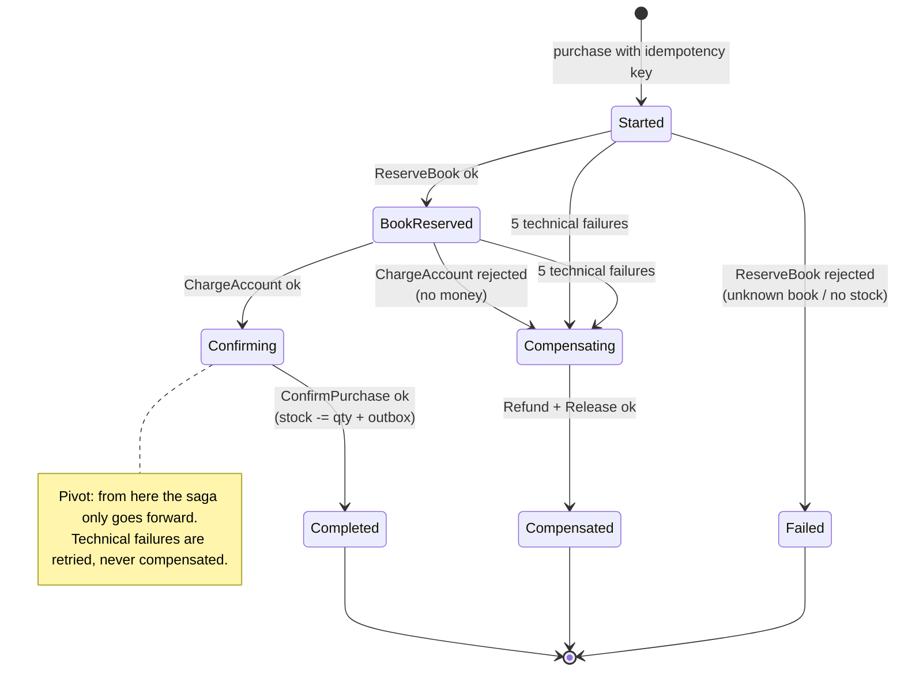

# Cloud-Computing-Task

A small bookstore on **Azure Service Fabric**. A user buys a book: money is taken from the user's bank
account and the books are removed from stock, and the two stay consistent even when requests are
repeated or a service fails halfway through.

The purchase is a **saga** (orchestration, built with the **command pattern**), with an **outbox**
in the participants and an **idempotency key** for every order.

## Services

| Service | Type | Role |
| --- | --- | --- |
| **front** | React | Shop page (buy) and Orders page |
| **Client** | stateless, ASP.NET Core Web API | HTTP entry point, rate limiting, maps transient errors to 503/504 |
| **Validator** | stateless | Field validation (`400`), routes the purchase to its orchestrator partition |
| **PurchaseOrchestrator** | stateful, 4 partitions (key: purchase id) | Runs the purchase saga, keeps the saga log |
| **BookstoreService** | stateful, 4 partitions (key: book id) | Saga participant: reserve / confirm / release books, sales outbox |
| **BankService** | stateful, 4 partitions (key: user id) | Saga participant: charge / refund, balance outbox |
| **ReportService** | stateless | Sales report, fed by the Bookstore outbox |
| **PostgreSQL** | database `cloud_computing_task` | Tables `users`, `books`, `orders`, `saga_log` |

Partition keys are MurmurHash3 (64-bit) of the id, used directly as the `UniformInt64` partition key
(`Common/PartitionHelper.cs`).

## Purchase saga

Every step is one **command** object (`PurchaseOrchestrator/Saga/Commands`). The orchestrator only knows
the table "current state → command → next state" (`PurchaseOrchestrator/Saga/PurchaseSaga.cs`):

| State | Command | Success → | Rejected → |
| --- | --- | --- | --- |
| `Started` | `ReserveBookCommand` | `BookReserved` | `Failed` (nothing to undo) |
| `BookReserved` | `ChargeAccountCommand` | `Confirming` | `Compensating` |
| `Confirming` (pivot) | `ConfirmPurchaseCommand` | `Completed` | `Failed` |
| `Compensating` | `CompensateCommand` = `RefundAccountCommand` + `ReleaseBookCommand` | `Compensated` | `Failed` |

- **Business rejection** (not enough stock or money) is a `StepResult` with `Succeeded = false` → "Rejected" column.
- **Technical failure** (timeout, failover) is an exception → the same command is retried with backoff
  (2^attempts s, max 30 s). Before the pivot the saga gives up after 5 attempts and compensates.

## Reliability

### Idempotency key

The front generates an idempotency key (UUID) when the user presses **BUY** and sends it with the
purchase. The key is also the purchase id and selects the orchestrator partition, so a repeated request
always reaches the partition that already holds the saga. If the saga exists, no second purchase starts;
the caller gets the stored state:

| Saga state | Response |
| --- | --- |
| `Completed` | `200` Order is already successfully created |
| still running / waiting for retry | `202` Order is successfully created and is being processed |
| `Compensated` / `Failed` | `409` with the reason |

Every response carries `transactionId` and `idempotencyKey`.

### Idempotent participants (txId)

Every command carries the saga's `TransactionId`. Bookstore (`reservations`) and Bank (`charges`) store
one record per txId, so repeating a command returns the first outcome. Rejections and compensations that
arrive before the forward step leave a **tombstone**, so a late `Reserve` / `Charge` does nothing.

### Orchestrator failure

Rule for every step: **write the state first, then execute the command.**

1. append a full snapshot of the saga to `public.saga_log` (Postgres, append-only),
2. commit it to the replicated reliable dictionary `sagas`,
3. only then call the participant.

Whenever a replica becomes primary (start, failover, restart), `RunAsync`:

1. restores unfinished sagas of its partition from `saga_log` that are missing in `sagas`,
2. keeps resuming every unfinished saga from its stored state (with backoff).

Because every command is idempotent, running a step again after a crash is safe.

### Outbox

- **Bookstore**: `ConfirmAsync` removes the books from stock (`stock -= qty`) and enqueues a `SaleEvent`
  into `salesOutbox` in **the same transaction**. A pump delivers it at-least-once to Postgres
  (`books.quantity`, absolute value) and ReportService (upsert by purchase id), and dequeues only after both succeeded.
- **Bank**: every balance change enqueues `BalanceChanged` into `balanceOutbox` in the same transaction;
  a pump writes it to `users.balance`.

Reserve only *holds* books (`heldStock`), so stock is never removed for a purchase that is later compensated.

## Database (PostgreSQL)

| Table | Written by | Purpose |
| --- | --- | --- |
| `users` | BankService (outbox pump) | Users and balances; loaded into the Bank at startup |
| `books` | BookstoreService (outbox pump) | Books, stock, prices; loaded into the Bookstore at startup |
| `orders` | PurchaseOrchestrator | Current state of every order (read view) |
| `saga_log` | PurchaseOrchestrator | Append-only saga log, used to resume sagas |

Each service owns its database code in its `Database/` folder: one `DbContext` plus `Get…Queries`
(reads) and `Post…Queries` (writes), LINQ only. The tables are created manually (no migrations at startup).

## HTTP API (Client)

| Method | Route | Result |
| --- | --- | --- |
| `POST` | `/api/Client/Purchase` | `200` / `202` / `400` / `409` (see above); `429` above 5 requests/s per IP |
| `GET` | `/api/Client/Orders?userId=` | Orders of a user (fan-out over all orchestrator partitions) |
| `GET` | `/api/Client/Report` | Sales report |

Transient backend errors are returned as `503` (service / partition unavailable) or `504` (timeout),
so a caller may retry them with the same idempotency key.

## Running locally

1. Start PostgreSQL: `CloudTask/CloudTask/Scripts/Start-Database.ps1` (also called by the deploy script).
2. Deploy to the local cluster (Visual Studio publish, or
   `Deploy-FabricApplication.ps1 -PublishProfileFile PublishProfiles\Local.1Node.xml`).
3. Front: `cd front && npm install && npm start` → http://localhost:3000.
