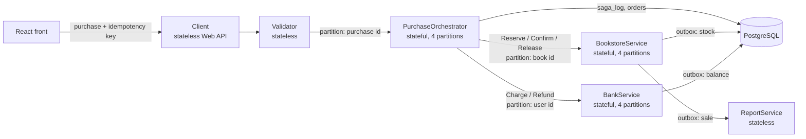
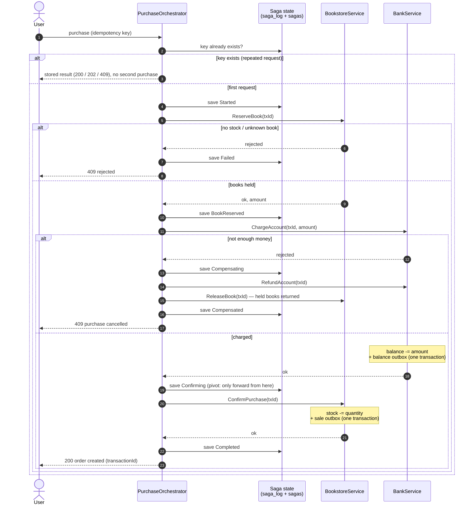

# Cloud-Computing-Task

## System design

## Saga pattern

What happens when a purchase comes in. Before every command the orchestrator saves the saga state
(saga_log + reliable dictionary), so after a crash it continues from the last saved state.

On a timeout or failover the same command is retried (it is idempotent by txId); before the pivot,
after 5 failed attempts the saga compensates instead.
