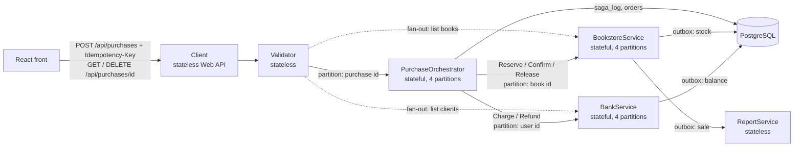
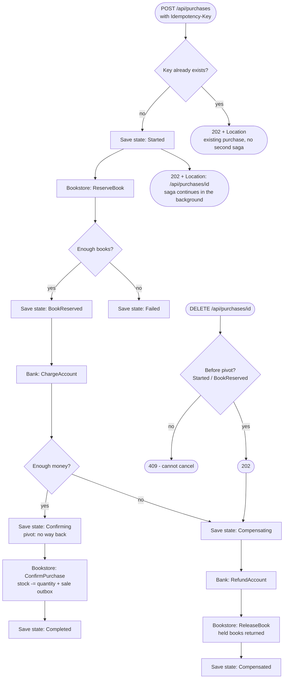

# Cloud-Computing-Task

## System design

## Saga pattern

The front follows the purchase with `GET /api/purchases/{id}` until the state is `Completed`,
`Compensated` or `Failed`.

Every "Save state" is written to `saga_log` (PostgreSQL) and the reliable dictionary before the next
step, so if the orchestrator goes down it continues from the last saved state. Every call carries the
txId, so repeating it after a crash is safe.
